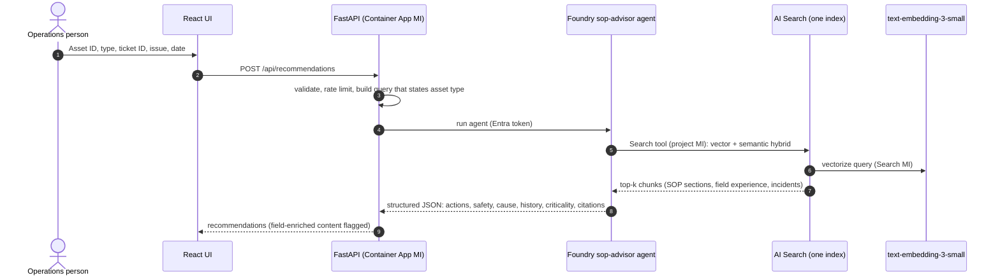
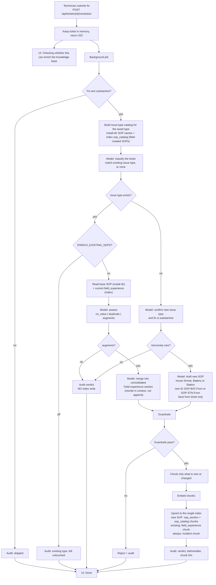
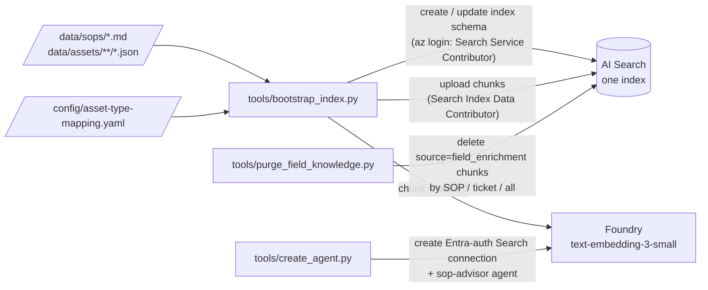

# Solution Architecture & Design — Field Knowledge Enrichment (POC)

Companion to [01-requirements-specification.md](./01-requirements-specification.md) (FR-/NFR-/SEC- IDs, decisions P1–P7, open items Q1–Q9) and [03-technical-specification.md](./03-technical-specification.md) (contracts and schemas).

## 1. Design summary

| Concern | Decision |
|---|---|
| UI | React (Vite) single-page app, served as static files by the backend container. |
| Backend | Python **FastAPI** on one **Azure Container App** — anonymous ingress, **system-assigned managed identity**. |
| Corpus | SOPs and asset JSON **packaged in the application install directory** (`/app/data`, read-only). The backend reads them directly. |
| Advice | One **Foundry agent** (`gpt-5.4`) with the **Azure AI Search knowledge tool**; the asset type is stated in the natural-language query. |
| Index | **One** Azure AI Search index, hybrid (keyword + vector) + semantic ranking; embeddings from `text-embedding-3-small`. |
| Index loading | **Push from code** (no blob, no indexer): initial bootstrap from the laptop; incremental updates from the Container App. |
| Learning | Ticket resolution → **issue-type detection** against SOP names → *exists*: value assessment + merge into the SOP's *Field experience*; *new*: draft a **new SOP** → **index only**. |
| Durable store | The Azure AI Search index is the only durable store of enriched knowledge (P1). |
| Identity | Entra only. Container App MI → Search + Foundry. Foundry project MI → Search (agent knowledge tool). Search MI → embedding deployment (vectorizer). |
| Build / deploy | `az acr build` (cloud build, no local Docker) + Bicep. |

### Why the push model and not an indexer
Indexers read from a data source (blob, ADLS, SQL, Cosmos …). Blob and Cosmos are ruled out, and the corpus lives in the app directory, so there is nothing for an indexer to read. The Search SDK's `upload / merge / delete` document operations give the same incremental result immediately. Chunking and embedding run in our code. The index still defines a **vectorizer**, so the Search service can embed *query* text itself — which the Foundry Search tool needs.

## 2. System context

```mermaid
%%{init: {"theme":"base","themeVariables":{"background":"#ffffff","primaryColor":"#ffffff","primaryTextColor":"#263445","primaryBorderColor":"#829bb3","lineColor":"#829bb3","secondaryColor":"#f8fafc","tertiaryColor":"#ffffff","clusterBkg":"#fafbfc","clusterBorder":"#cbd2d9","edgeLabelBackground":"#ffffff","fontFamily":"Segoe UI, Arial, sans-serif","fontSize":"14px"},"flowchart":{"curve":"linear","nodeSpacing":55,"rankSpacing":75,"padding":18,"htmlLabels":true}}}%%
flowchart TD
    subgraph CLIENTS["External clients"]
        direction LR
        OPS["Operations person"]
        TECH["Field technician"]
    end

    subgraph DEPLOYMENT["Application deployment · South India"]
        subgraph ENV["Existing shared Container Apps environment · pcdotai-agent"]
            subgraph APP["Solution-owned Container App · single replica · system-assigned managed identity"]
                direction TB
                UI["React UI<br/>Static files served by FastAPI"]
                API["FastAPI backend<br/>Validation · recommendations · resolution jobs"]
                ENR["Enrichment pipeline<br/>Classify · assess · merge or draft<br/>Guardrails · chunk · embed · index"]

                subgraph FILES["Container-local files · not external storage"]
                    direction LR
                    CORPUS["Packaged corpus · /app/data<br/>SOPs and asset JSON · read-only"]
                    CONFIG["Packaged configuration · /app/config<br/>Asset-type applicability mapping"]
                    AUDIT["Ephemeral runtime · /app/runtime<br/>Audit log · not durable"]
                end

                UI -->|"HTTP /api · same origin"| API
                API -->|"Accepted resolution · background job"| ENR
                API ---|"Read packaged corpus"| CORPUS
                ENR ---|"Read packaged corpus"| CORPUS
                ENR ---|"Append audit records"| AUDIT
                CONFIG -.->|"Applicability rules"| ENR
            end
        end
    end

    subgraph SHARED["Existing shared AI services · outside application deployment"]
        direction LR

        subgraph FOUNDRY["Microsoft Foundry · ai-foundry-common-ihub · Sweden Central"]
            subgraph PROJECT["Existing Foundry project · project managed identity"]
                subgraph AGENTOWN["Solution-owned agent and connection"]
                    AGENT["sop-advisor agent<br/>Grounded recommendations<br/>Entra-authenticated AI Search tool"]
                end
            end

            subgraph MODELS["Shared model deployments"]
                direction LR
                GPT["gpt-5.4<br/>Generation and structured assessment"]
                EMB["text-embedding-3-small<br/>Document and query embeddings"]
            end
        end

        subgraph SEARCH["Azure AI Search · ai-search-vector-001 · Switzerland North"]
            subgraph INDEXOWN["Solution-owned logical index namespace"]
                IDX["ke-&lt;env&gt;-knowledge · ONE index<br/>Hybrid search and semantic ranking<br/>SOPs · catalog · profiles · incidents · field experience<br/>Only durable enriched-knowledge store"]
            end
        end
    end

    subgraph SUPPORT["Supporting build and administration · outside application deployment"]
        direction LR
        DEV["Developer laptop · Entra sign-in<br/>Bicep deployment · bootstrap · agent setup"]
        ACR["Existing Azure Container Registry<br/>pcdotaiagentd10b5a<br/>Cloud-built application image"]
    end

    OPS -->|"HTTPS · anonymous ingress"| UI
    TECH -->|"HTTPS · anonymous ingress"| UI

    API -->|"HTTPS · invoke agent · App MI"| AGENT
    AGENT -->|"Model inference"| GPT
    AGENT -->|"HTTPS · knowledge retrieval · Project MI"| IDX
    ENR -->|"HTTPS · classify / assess / merge / draft · App MI"| GPT
    ENR -->|"HTTPS · embed changed chunks · App MI"| EMB
    ENR -->|"HTTPS · catalog lookup / upsert / delete · App MI"| IDX
    IDX -->|"HTTPS · query vectorization · Search MI"| EMB

    DEV -.->|"az acr build · package code, corpus and config"| ACR
    DEV -.->|"Bicep · deployment, settings and RBAC"| APP
    ACR -.->|"Image pull · AcrPull via App MI"| APP
    DEV -.->|"Create agent and Entra Search connection"| AGENT
    DEV -.->|"Create index schema"| IDX
    DEV -->|"Bootstrap · embed seed chunks"| EMB
    DEV -->|"Bootstrap · upload seed documents"| IDX

    classDef component fill:#ffffff,stroke:#829bb3,stroke-width:1px,color:#263445;
    class OPS,TECH,UI,API,ENR,CORPUS,CONFIG,AUDIT,AGENT,GPT,EMB,IDX,DEV,ACR component;

    style CLIENTS fill:#ffffff,stroke:#cbd2d9,stroke-width:1px
    style DEPLOYMENT fill:#fafbfc,stroke:#cbd2d9,stroke-width:1px
    style ENV fill:#ffffff,stroke:#cbd2d9,stroke-width:1px,stroke-dasharray:5 4
    style APP fill:#ffffff,stroke:#cbd2d9,stroke-width:1px
    style FILES fill:#fafbfc,stroke:#cbd2d9,stroke-width:1px
    style SHARED fill:#ffffff,stroke:#cbd2d9,stroke-width:1px,stroke-dasharray:5 4
    style FOUNDRY fill:#fafbfc,stroke:#cbd2d9,stroke-width:1px,stroke-dasharray:5 4
    style PROJECT fill:#ffffff,stroke:#cbd2d9,stroke-width:1px,stroke-dasharray:5 4
    style AGENTOWN fill:#ffffff,stroke:#cbd2d9,stroke-width:1px
    style MODELS fill:#ffffff,stroke:#cbd2d9,stroke-width:1px,stroke-dasharray:5 4
    style SEARCH fill:#fafbfc,stroke:#cbd2d9,stroke-width:1px,stroke-dasharray:5 4
    style INDEXOWN fill:#ffffff,stroke:#cbd2d9,stroke-width:1px
    style SUPPORT fill:#ffffff,stroke:#cbd2d9,stroke-width:1px

    linkStyle default stroke:#829bb3,stroke-width:1px;
```



### Components

| Component | Responsibility | Location |
|---|---|---|
| React UI | Ticket form, criticality, recommendations panel, fix text area, neutral enrichment status. | `src/ui` |
| API | Endpoints, validation, rate limiting, query building, agent invocation, in-memory ticket handling. | `src/knowledge_enrichment/api` |
| Corpus loader | Parses SOP file names/headers/sections and asset JSON from `/app/data`; builds the issue-type catalog. | `src/knowledge_enrichment/corpus` |
| Advisor agent | Grounded recommendations via the Azure AI Search tool. Single agent. | definition in `src/knowledge_enrichment/agents`, created by `tools/create_agent.py` |
| Enrichment engine | Issue-type classification, value assessment, merge, new-SOP drafting, guardrails, index writes, audit. Plain code with direct model calls and structured output — a deterministic pipeline, not an autonomous agent. | `src/knowledge_enrichment/enrichment` |
| KB library | Chunkers, embeddings client, Search clients, index schema. Shared by API, engine and CLI. | `src/knowledge_enrichment/kb` |
| Tools (CLI) | Bootstrap index, create agent/connection, purge field knowledge. | `tools/` |
| Infra | Bicep for Container App, identities, role assignments. | `infra/` |

## 3. The single index and asset-type awareness

One searchable index `ke-<env>-knowledge`. Every document is a chunk; `doc_type` says what kind.

| `doc_type` | Content | Origin |
|---|---|---|
| `sop_section` | One section of an SOP (symptoms, steps, safety, …). | Seed from `data/sops` (bootstrap) **or** a new field-created SOP (runtime) |
| `sop_catalog` | One short record per SOP: ID, issue type (title), asset type(s), error codes, severity, summary. Used for **issue-type detection** and searchable by symptoms. | Seed and field-created |
| `field_experience` | One consolidated, LLM-merged section per SOP: "what technicians actually found and did", grouped by cause/fix, with ticket references. | Runtime (existing-issue-type path) |
| `incident` | One past incident (asset ID, symptoms, root cause, fix, ticket, date). | Seed from asset JSON (bootstrap) and runtime |
| `asset_profile` | Asset summary and known issues. | Seed from asset JSON |

Key fields (full schema in the technical specification): `content`, `content_vector` (1536), `doc_type`, `applies_to` (collection: `battery`/`station`), `sop_id`, `issue_type`, `error_codes`, `severity`, `asset_id`, `source` (`seed`/`field_enrichment`), `revision`, `source_tickets`, `updated_at`.

### How the index "appreciates" battery vs station (FR-10…14)
No separate indexes and no hard filter on the agent path. Instead, three reinforcing signals:

1. **The query states it.** The backend always composes the query as `"<Battery|Station> issue (asset <id>): <nature of issue>"`.
2. **The chunk states it.** Each chunk's text begins with a context header, e.g.
   `Asset type: Battery | SOP-BAT-001 Battery Over Temperature Thermal Event | Section: Battery fault (E-604)`.
   Keyword, vector and semantic ranking all see it; the semantic configuration uses it as the title field.
3. **The agent is told.** Agent instructions require using only knowledge whose header says the stated asset type, and to flag anything for the other type.

`applies_to` is also stored as a filterable field (used by the catalog lookup, the purge CLI and as the fallback described in Q2). Applicability comes from the SOP ID prefix plus overrides in `config/asset-type-mapping.yaml`.

## 4. Runtime flows

### 4.1 Ticket → recommendations



### 4.2 Fix submitted → issue-type detection → enrichment



Key behaviours
- **Neutral UX (FR-22):** the status endpoint returns only `checking` or `done`.
- **Install directory is read-only and is not updated (P5, SEC-08).** A field-created SOP exists only in the index. Because the catalog also reads field-created SOPs from the index, the next ticket of the same new type matches it instead of creating another (acceptance test 7).
- **What "the SOP" means at query time:** the base SOP (seed chunks) plus its `field_experience` chunk. When blob storage arrives, the merge can be written back into the SOP file itself.
- **Merge, not append (FR-34):** the merge prompt gets the current Field-experience text, the new fix and the verdict, and returns a rewritten consolidated section (groups by cause → fix, removes repeats, keeps ticket references). The previous text is stored on the chunk (`previous_content`) for one-step undo.
- **No invention (FR-36):** the SOP-drafting prompt is restricted to facts in the ticket; unknown sections read "Not yet established"; guardrails reject invented error codes, part numbers, thresholds and safety steps that are not in the input.
- **Concurrency (NFR-09):** single replica + in-process lock per SOP ID.
- **Resilience:** jobs and statuses are in memory (A8). A job interrupted by a restart is lost; the audit entry says so, and the ticket can be resubmitted. Min replicas = 1 so scale-to-zero does not kill background work.
- **Idempotency (FR-42):** chunk IDs are deterministic (`<sop_id>__<section_key>`, `<asset_id>__<ticket_id>__incident`; Search keys allow only letters, digits, `_`, `-`, `=`), so a retry overwrites rather than duplicates.

### 4.3 Closed loop
After 4.2, the new or changed chunks exist in the index with `source=field_enrichment`. The next ticket flows through 4.1; the agent retrieves them and the UI labels them as field-derived (FR-05, FR-44).

## 5. Bootstrap and housekeeping (from the laptop)



- The same `kb` library is used by CLI and app, so first load and incremental updates cannot diverge.
- Bootstrap is idempotent (deterministic IDs) and keeps field-derived chunks unless `--reset`.
- Chunking: SOPs split at `##` headings; each chunk carries the SOP header context. One `sop_catalog` chunk per SOP. Asset JSON → one `asset_profile` chunk and one `incident` chunk per incident.

## 6. Identity and access (Entra only, no keys)

| Principal | Resource | Role | Purpose |
|---|---|---|---|
| **Container App managed identity** | Search `ai-search-vector-001` | **Search Index Data Contributor** | search and update the index |
| Container App managed identity | Foundry `ai-foundry-common-ihub` | **Azure AI User** | invoke the agent; call `gpt-5.4` and `text-embedding-3-small` |
| Container App managed identity | ACR `pcdotaiagentd10b5a` | **AcrPull** | pull the image |
| **Foundry project managed identity** (agent identity) | Search | **Search Index Data Reader** + **Search Service Contributor** | agent knowledge tool queries the index |
| **Search service managed identity** | Foundry account | **Cognitive Services OpenAI User** | vectorizer embeds query text |
| Deployer (you) | Search | Search Service Contributor + Index Data Contributor *(held)* | create index and load corpus |
| Deployer (you) | Foundry project | Azure AI User + Owner *(held)* | create agent and connection |

Notes
- The anonymous-facing identity gets **data-plane rights only** on Search (it cannot change the schema). If you prefer the app to self-create the index, add *Search Service Contributor* — not recommended.
- The project currently has an **API-key** Search connection (`aisearchvector001l620n4`); a **new Entra-authenticated connection** is created for this solution and the old one is untouched.
- After validating, set Search `disableLocalAuth=true` (SEC-07).

## 7. Agreed decisions
All agreed on 2026-11-17 (see requirements spec §9).

| # | Decision | Outcome |
|---|---|---|
| Q1 | Existing issue types | **Enrich** as the SOP's Field experience section in the index; switchable via `ENRICH_EXISTING_SOPS`. |
| Q2 | Asset-type relevance | Soft (query + chunk header + agent instructions); app-side `applies_to` filter on the same index is the fallback if acceptance test 2 leaks. |
| Q4 | Applicability mapping | BAT-001/002 → Battery + Station; BAT-003 → Battery; STN-001/002/003 and GEN-001 → Station. |
| Q5 | LLM-drafted SOPs | Auto-applied as "Field-derived – not yet reviewed", with guardrails; approval switch available. |

## 8. Repository layout

```
knowledge-enrichment/
├─ README.md
├─ docs/                            01 requirements, 02 architecture, 03 technical specification
├─ data/                            corpus; copied into the image at /app/data
│  ├─ sops/                         SOP markdown (issue type is in the file name)
│  └─ assets/{batteries,stations}/  asset JSON snapshots
├─ config/
│  └─ asset-type-mapping.yaml       SOP and section applicability overrides
├─ src/
│  ├─ knowledge_enrichment/         Python package
│  │  ├─ api/                       FastAPI app, routers, schemas
│  │  ├─ corpus/                    SOP/asset parsing, issue-type catalog
│  │  ├─ agents/                    advisor agent definition + instructions
│  │  ├─ enrichment/                classify, assess, merge, draft SOP, guardrails, jobs, audit
│  │  ├─ kb/                        chunking, embeddings, search clients, index schema
│  │  └─ settings.py                env-based configuration
│  └─ ui/                           React (Vite) app
├─ tools/                           CLI: bootstrap_index, create_agent, purge_field_knowledge
├─ infra/                           Bicep (main + modules) and per-environment parameter files
├─ scripts/                         deploy.ps1 (az acr build + az deployment)
├─ tests/                           unit + closed-loop integration tests
├─ Dockerfile                       multi-stage: build UI → run FastAPI; copies data/ and config/
└─ .env.example
```

## 9. Deployment

1. `az acr build` builds the multi-stage image in ACR `pcdotaiagentd10b5a` (corpus and config are copied into `/app/data` and `/app/config`).
2. Bicep deploys the Container App into environment `pcdotai-agent`: system-assigned identity, external **anonymous** ingress, min = max = 1 replica, env vars from `infra/params/<env>.bicepparam`, ACR pull via MI; plus the role assignments in §6 (cross-resource-group modules).
3. Once per environment, from the laptop: `tools/bootstrap_index.py`, then `tools/create_agent.py`.
4. Smoke test, then the closed-loop test (acceptance 4–8).
5. New environment = new parameter file + new index prefix + new Container App name; the same image is promoted.

## 10. Observability and testing
- OpenTelemetry → Application Insights; `ticket_id` correlates classification → verdict → merge/draft → index write. The audit record is also appended to `/app/runtime/audit.jsonl`.
- Tests: corpus/catalog parsing and tagging; chunking and IDs; guardrails (adversarial fixtures: injection text, invented part numbers, deleted safety steps); closed loop against the dev index (duplicate ⇒ no write; augmenting ⇒ field experience; new issue ⇒ new SOP; second ticket ⇒ matches new SOP; enriched content retrieved by the agent).

## 11. Risks
| Risk | Mitigation |
|---|---|
| Anonymous users poison the knowledge base | Input limits, rate limit, prompt-injection-aware prompts, guardrails, "not yet reviewed" label, audit, purge CLI, optional approval. |
| LLM-drafted SOP contains unsafe or invented guidance | Facts limited to ticket text, "Not yet established" for gaps, guardrail against invented specifics, labelled unreviewed. |
| Soft asset-type relevance leaks the wrong type | Triple signal (query, chunk header, agent instruction); acceptance test; app-side filter fallback. |
| Wrong issue-type match creates duplicate or misfiled SOPs | Candidate catalog restricted to the asset type; model must justify "no fit"; second-ticket acceptance test. |
| Index is the only durable store | POC-only; purge + re-bootstrap recovers a clean state; blob storage at next stage. |
| Cross-region latency, free semantic tier | Acceptable for POC. |
| In-flight jobs lost on restart | Documented (A8); resubmit; min replicas 1. |
